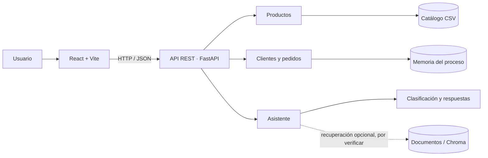
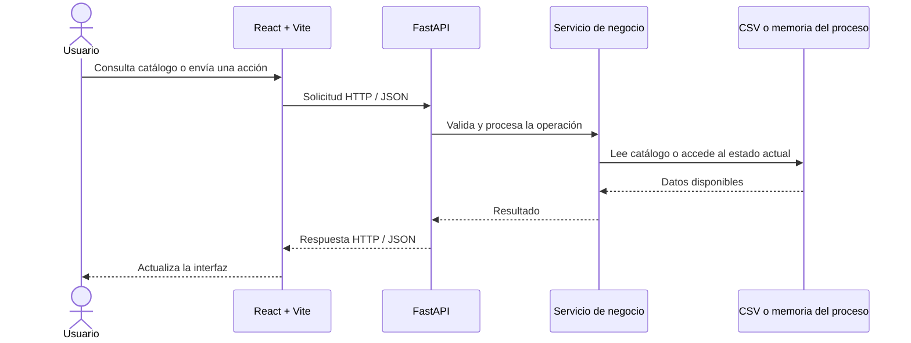
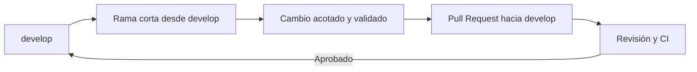

# Flash-Bites

Flash-Bites es una aplicación web para apoyar la operación de pequeños negocios de comida. Reúne un catálogo de productos, registro de clientes, gestión básica de pedidos y un asistente conversacional.

> **Estado:** proyecto en reorganización. Algunas funciones son demostrativas: clientes y pedidos se mantienen en memoria y se pierden al reiniciar el backend. La autenticación actual no persiste cuentas ni verifica contraseñas. No usar para procesar pedidos reales sin completar esos componentes.

## Stack actual

- **Frontend:** React 18, Vite y Tailwind CSS.
- **Backend:** Python, FastAPI y Pydantic.
- **Catálogo:** archivo CSV en `backend/documents/productos.csv`.
- **Contenedores:** Docker y Docker Compose.
- **Asistente:** lógica de clasificación y respuestas; las dependencias y el comportamiento de RAG deben verificarse antes de considerarlo una función disponible.

La configuración incluye `DATABASE_URL`, pero actualmente los servicios de clientes y pedidos no usan una base de datos. La elección e implementación de persistencia se documentará antes de migrar esos datos.

## Arquitectura y flujo

La aplicación se organiza como un monolito modular: el frontend consume una API FastAPI y esta aplica las reglas del negocio. El diagrama refleja el comportamiento actual del repositorio.



Flujo de una solicitud:



## Estructura objetivo

La reorganización de carpetas se hará gradualmente; esta es la estructura acordada, no una afirmación de que todas las carpetas ya existan.

```text
.
├── .github/                 # Plantillas y automatización de GitHub
├── docs/
│   ├── arquitectura/
│   ├── backend/
│   ├── base-de-datos/
│   ├── frontend/
│   ├── gestion-github/
│   ├── infraestructura/
│   ├── modelado/
│   ├── scrum/
│   ├── ui-ux/
│   └── README.md            # Índice de documentación
├── backend/                 # API FastAPI
├── frontend/                # Aplicación React + Vite
├── database/                # Migraciones y scripts de datos
├── infrastructure/          # Configuración y recursos de despliegue
├── docker-compose.yml
├── CONTRIBUTING.md
└── README.md
```

## Ejecución local

Requisitos: Python 3.11 o superior y Node.js 20 o superior.

### Backend

```bash
cd backend
python -m venv .venv
# Windows PowerShell: .venv\Scripts\Activate.ps1
# Linux/macOS: source .venv/bin/activate
python -m pip install -r requirements.txt
uvicorn app.main:app --reload
```

La API queda en `http://localhost:8000` y su documentación interactiva en `http://localhost:8000/docs`.

### Frontend

En otra terminal:

```bash
cd frontend
npm ci
npm run dev
```

Configura `VITE_API_URL` para que apunte a `http://localhost:8000/api/v1`. Vite inicia normalmente en `http://localhost:5173`.

## Documentación

- [Guía para contribuir](CONTRIBUTING.md): ramas, Pull Requests y validaciones.
- [Catálogo de productos](docs/catalogo.md): formato CSV y contrato de la API.
- [Revisión técnica y plan de trabajo](docs/revision-y-plan.md): hallazgos, decisiones pendientes y backlog propuesto.

La documentación de instalación y despliegue se consolidará en `docs/` y se enlazará aquí cuando esté alineada con la configuración vigente.

## Flujo de trabajo

Todas las ramas de trabajo parten de `develop` y se integran mediante Pull Request hacia `develop`. Usa nombres breves que describan el cambio, por ejemplo `docs/arquitectura`, `fix/pedidos` o `chore/postgres`.



Consulta [CONTRIBUTING.md](CONTRIBUTING.md) para los pasos y criterios del Pull Request.
